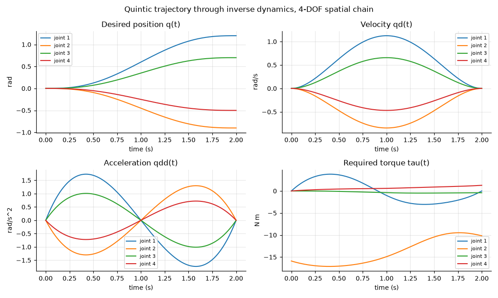
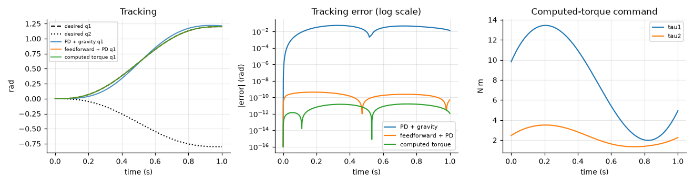
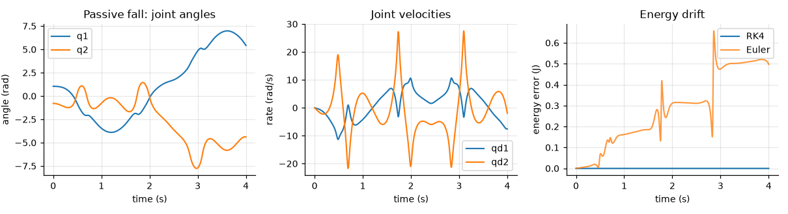
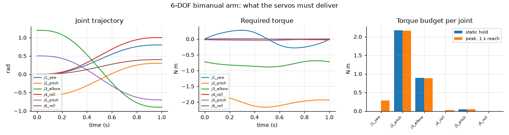

# `robot_dynamics`

**A general N-DOF rigid-body dynamics library for serial manipulators, implementing
the Lagrangian formulation together with Featherstone's recursive algorithms.**

Computes the equation of motion

\(\tau = M(q)\,\ddot q + C(q,\dot q)\,\dot q + G(q) - J^\top f_{\text{ext}}\)

in both directions — inverse dynamics for control, forward dynamics for simulation —
with trajectory generation and model-based control on top.

The same code path handles 2 degrees of freedom and 24. There is no `if n == ...`
branch anywhere in the library.

---

## Why

Three reasons this exists rather than reaching for an established simulator:

**To derive rather than call.** The Lagrangian backend assembles $M$, $C$ and $G$
from first principles — kinetic and potential energy, Christoffel symbols — because
the point is to understand where the equations come from, not to obtain a number.

**To validate independently.** Featherstone's RNEA, CRBA and ABA provide
additional dynamics formulations for the same model. They share the robot and
kinematic representation and selected low-level spatial-model helpers, but the
core dynamics calculations are implemented through different formulations.
Agreement to $10^{-14}$ provides strong cross-validation evidence; agreement
within a single formulation does not. That cross-check found two genuine bugs
during development, both documented in [`docs/theory.md`](docs/theory.md#6-errors-found-during-development).

**To answer engineering questions.** The library ships with the 6-DOF arm from a
companion Gazebo mobile-manipulator project, whose *kinematics* were already
validated. Dynamics answers the next question: the shoulder pitch must hold
2.17 N·m statically, 3.74 N·m with a 0.5 kg payload, and peaks at 2.16 N·m over a
one-second reach. Those are servo-specification numbers.

---

## Installation

```bash
pip install -e ".[dev]"        # everything, including SymPy and matplotlib

pip install -e .              # numerical layer only, NumPy is the sole dependency
```

Python 3.10+.

---

## Minimal example

```python
import numpy as np
import robot_dynamics as rd

robot = rd.planar_chain(3)                    # or build from Link/Joint directly

q   = np.array([0.3, -0.6,  0.9])
qd  = np.array([0.5,  0.2, -0.4])
qdd = np.array([1.0, -0.5,  0.3])

tau = robot.inverse_dynamics(q, qd, qdd)      # what the actuators must deliver
qdd_back = robot.forward_dynamics(q, qd, tau) # and back again

assert np.allclose(qdd_back, qdd)

M = robot.mass_matrix(q)                      # the terms individually
C = robot.coriolis(q, qd)
G = robot.gravity_torque(q)

assert np.allclose(tau, M @ qdd + C @ qd + G)
```

Building a model explicitly:

```python
from robot_dynamics import Joint, Link, Robot
from robot_dynamics.utils import transform

robot = Robot(
    links=[Link(mass=1.2, com=[0.15, 0, 0], inertia=np.diag([1e-3, 2e-2, 2e-2])),
           Link(mass=0.8, com=[0.10, 0, 0], inertia=np.diag([1e-3, 1e-2, 1e-2]))],
    joints=[Joint('revolute', axis=[0, 0, 1]),
            Joint('revolute', axis=[0, 1, 0],
                  origin=transform(np.eye(3), [0.30, 0, 0]))],
    gravity=(0, 0, -9.81),
)
```

Choosing a backend explicitly — this is how the test suite cross-validates:

```python
robot.mass_matrix(q, method='crba')          # O(n^2), the default
robot.mass_matrix(q, method='lagrangian')    # from the kinetic energy

robot.inverse_dynamics(q, qd, qdd, method='rnea')        # O(n), default
robot.inverse_dynamics(q, qd, qdd, method='lagrangian')  # Lagrangian formulation

robot.forward_dynamics(q, qd, tau, method='aba')         # O(n), default
robot.forward_dynamics(q, qd, tau, method='lagrangian')  # Cholesky solve
```

---

## Architecture

```text
                        Robot model

                    (Link, Joint, Robot)
                             |
                             |
                         Kinematics

              (link transforms, Jacobians, COM Jacobians)
                             |
                    +--------+--------+
                    |                 |
               Lagrangian        Featherstone
                                    RNEA  (tau, O(n))
               M from kinetic      CRBA  (M,   O(n^2))
               energy; G from     ABA   (qdd, O(n))
               potential; C from
               Christoffel symbols
                    |                 |
                    +--------+--------+
                             |
                      Forward dynamics

                   (linear solve, never M^-1)
                             |
                         Simulation

                            (RK4)
                             |
                          Control

              (PD + gravity, computed torque, feedforward)

    Symbolic layer (SymPy) sits OFF to the side: it derives and audits the
    equations and can compile them into NumPy callables, but is never imported
    by the numerical path. That boundary is enforced by a test and again in CI.
```

```text
src/robot_dynamics/

├── utils/          rotations, homogeneous transforms, spatial (Plucker) algebra
├── models/         Link, Joint, Robot, and ready-made example robots
├── kinematics/     forward kinematics, Jacobians, COM Jacobians
├── dynamics/       lagrangian, rnea, crba (+ aba), symbolic
├── trajectory/     quintic and cubic polynomials, multi-waypoint
├── control/        PD+gravity, computed torque, feedforward+PD
└── simulation/     RK4 integration, energy and tracking-error reporting
```

---

## Results

Run `python examples/03_trajectory_torques.py` etc. to regenerate every figure.

### A trajectory and the torques it demands



A quintic rest-to-rest motion on a 4-DOF spatial chain, and the joint torque it
requires. The shoulder peaks at 17.1 N·m against a 15.9 N·m static hold — for this
motion gravity dominates and acceleration adds only about 8 %.

### Model-based control



Same arm, same gains, same step. Measured maximum tracking error:

| controller                | max abs error   |
| ------------------------- | --------------- |
| PD + gravity compensation | 5.4 × 10⁻² rad  |
| feedforward + PD          | 4.2 × 10⁻¹⁰ rad |
| computed torque           | 1.6 × 10⁻¹¹ rad |

A factor of $10^9$, from nothing but knowing $M$ and $C$.

### Energy conservation



A torque-free arm falling under gravity. RK4 at 1 ms drifts by 4 × 10⁻⁹ relative over
4 s; explicit Euler at the same step drifts by 7 × 10⁻². This doubles as a test of the
dynamics — the algebraic identities are all evaluated at a single instant, whereas
drift accumulates.

### The companion 6-DOF arm



Static hold versus peak torque per joint for the arm from the Gazebo project.

---

## Validation

Full measured report: [`docs/validation.md`](docs/validation.md), regenerated by
`python docs/generate_validation.py` and checked in CI so it cannot go stale.

**316 tests** over 13 models spanning $n = 2$ to $n = 9$ — planar, spatial, randomly
generated, mixed revolute/prismatic, pure-prismatic gantry, and the real 6-DOF arm.

| what is checked                      | result                         |
| ------------------------------------ | ------------------------------ |
| Lagrange vs RNEA (torque)            | ≤ 8.3 × 10⁻¹⁶                  |
| Lagrange vs CRBA (mass matrix)       | ≤ 1.7 × 10⁻¹⁵                  |
| Lagrange vs ABA (acceleration)       | ≤ 1.6 × 10⁻¹⁴                  |
| Christoffel $C\dot q$ vs RNEA        | ≤ 1.5 × 10⁻¹⁵                  |
| vs closed-form 2-DOF hand derivation | ≤ 10⁻¹⁵ over 200 random states |
| vs SymPy Euler–Lagrange derivation   | ≤ 10⁻¹⁵                        |
| $M = M^\top$, $x^\top M x > 0$       | holds on every model           |
| $\dot M - 2C$ skew-symmetric         | ≤ 10⁻⁹                         |
| $\ddot q \to \tau \to \ddot q$       | ≤ 1.6 × 10⁻¹⁴                  |
| external wrench vs $-J^\top f$       | ≤ 10⁻¹⁴                        |

Two things make this more than self-congratulation. The property tests only prove
**self-consistency** — a model could satisfy all of them and still describe the wrong
robot — so the closed-form and SymPy comparisons are what pin down that the model is
the intended one. The Lagrangian and Featherstone backends use different core
dynamics formulations, so agreement between them provides a meaningful cross-validation
check despite their shared low-level model infrastructure.

Empirical scaling, from `benchmarks/bench_backends.py` (fit over $n \ge 4$):

| algorithm                   | measured exponent | expected |
| --------------------------- | ----------------- | -------- |
| RNEA inverse dynamics       | 0.98              | 1        |
| ABA forward dynamics        | 0.99              | 1        |
| CRBA mass matrix            | 1.20              | 2        |
| Lagrangian inverse dynamics | 2.43              | 3        |

CRBA measures below its asymptotic exponent because at these sizes per-link Python
overhead dominates the $O(n^2)$ work; the Lagrangian exponent is approaching 3 from
below for the same reason.

---

## Limitations

Stated explicitly, because a list of what a library does *not* do is more useful than
an implied claim that it does everything.

* **Fixed base only.** No floating-base dynamics, so no legged or free-flying robots.

* **Serial chains only.** No closed kinematic loops and no branched trees. The
  recursive algorithms are written against a `parent` array and would extend to a tree
  with modest work; loops need constraint handling that is absent.

* **No contact or collision.** External wrenches must be supplied by the caller;
  nothing detects contact or resolves interpenetration.

* **No joint friction, actuator dynamics, gear ratios or motor inertia.** These often
  dominate a real manipulator's behaviour at low speed.

* **Joint limits are recorded but never enforced** during simulation. A simulated arm
  will happily pass through its own limits.

* **Ideal rigid bodies.** No link flexibility or backlash.

* **No deployment-oriented code generation.** The symbolic layer can compile
  SymPy expressions into NumPy callables for offline evaluation, but the project
  does not generate optimized native code, GPU kernels, or hard-real-time
  controller code.

* **Symbolic derivation does not scale.** Expression size grows steeply with DOF; a
  full 6-DOF spatial chain can take minutes and produce unreadable output. Use it on
  2- and 3-DOF models to verify, and trust the recursive backends beyond that.

* **Single-threaded, dense linear algebra.** No sparsity exploitation.

---

## Project layout

```text
dynamics/

├── SPEC.md                     the Phase 0 specification, written before any code

├── README.md                   this file

├── src/robot_dynamics/         the library

├── tests/                      316 tests

├── examples/                   five runnable examples, generate every figure

├── benchmarks/                 backend cost against n

├── docs/

│   ├── theory.md               derivations, conventions, and the bugs found

│   ├── validation.md           measured error tables, regenerated by CI

│   ├── generate_validation.py

│   └── figures/

├── pyproject.toml

├── LICENSE                     MIT

└── .github/workflows/tests.yml Python 3.10-3.13, lint, tests, purity check
```

## Running things

```bash
pytest tests -q                              # the suite

python docs/generate_validation.py           # the measured error tables

python benchmarks/bench_backends.py          # scaling

cd examples && python 03_trajectory_torques.py
```

## References

R. Featherstone, *Rigid Body Dynamics Algorithms* (2008) for the recursive
algorithms and spatial-vector formalism. Spong, Hutchinson & Vidyasagar, *Robot
Modeling and Control* for the Lagrangian formulation and computed torque. Squire &
Trapp, *SIAM Review* 40(1) 1998 for complex-step differentiation.

## License

MIT.
